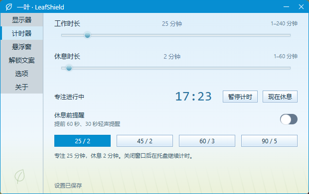
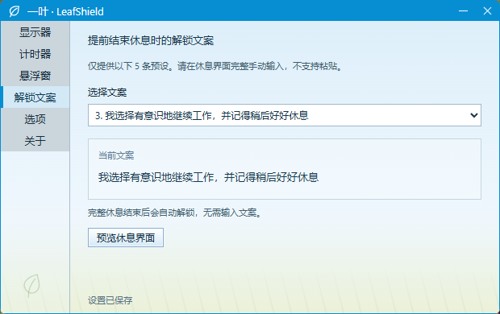
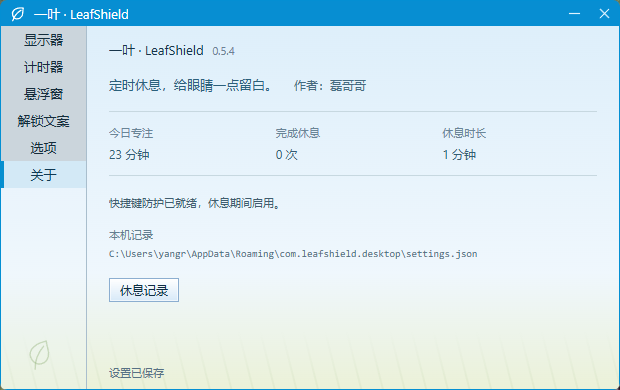

# LeafShield · 一叶

[简体中文](README.md) | English **Author: Leigg**

A desktop break reminder and screen adjustment utility built with Rust and Tauri 2. Scheduled breaks, full-screen photographs, and manually typed mindfulness phrases help you step away from continuous screen work.

Current version: **0.6.1**, with Windows x64 portable / installer packages and a macOS Universal DMG (Apple Silicon + Intel). Both the application and documentation support Chinese and English. Open 选项 (Options) → 语言 (Language), then choose `English` or `简体中文`. Changes apply immediately and persist.

## Download and run

Download from [Releases](https://github.com/chaseSpace/timetorest-rs/releases/latest):

| File                             | Purpose                                                               |
| -------------------------------- | --------------------------------------------------------------------- |
| `leafshield-0.6.1.exe`           | Portable executable; keep it in a stable location and run it directly |
| `LeafShield_0.6.1_x64-setup.exe` | Windows installer for the current user                                |
| `SHA256SUMS.txt`                 | SHA256 checksums for executables and license                          |
| `LICENSE`                        | MIT license                                                           |

macOS download: `LeafShield_0.6.1_universal.dmg`, with `SHA256SUMS-macos.txt` covering the DMG and LICENSE.

Microsoft Edge WebView2 Runtime is required on Windows. Production UI assets are embedded in the package: running the app does not start an HTTP server or require Node.js or Vite. Windows executables are not code-signed. The macOS app is ad-hoc signed without Developer ID signing or notarization.

1. Start the app and choose your durations. The default is **45 minutes of work / 2 minutes of rest**.
2. At break time, a separate always-on-top full-screen window covers each monitor. The break ends automatically at zero.
3. To finish early, move the mouse or press a key to reveal the unlock area, then manually type the selected phrase.
4. Closing the main window minimizes the app to the system tray while timing continues. Reopen or exit it from the tray.

**On Windows, start at login is enabled by default, including in portable mode.** Disable it under Options → Start at login. Login startup keeps the main window in the tray. After moving or renaming the executable, run it manually once to update the startup path according to your saved preference. Administrator rights are not required.

On macOS, open the DMG and drag LeafShield to Applications. Follow the first-launch approval prompts. For keyboard protection, grant Accessibility permission under System Settings → Privacy & Security and restart the app. See [Tauri macOS signing](https://v2.tauri.app/distribute/sign/macos/) for the ad-hoc signing limitations.

## Features

Language changes cover settings, break screens, the floating timer, tray, and reminders. The five unlock phrases switch to the matching language while keeping the selected preset number. Screenshots show the Chinese interface.

| Feature                   | Behavior                                                                                                                                                                               |
| ------------------------- | -------------------------------------------------------------------------------------------------------------------------------------------------------------------------------------- |
| Timer                     | Presets `25/2`, `45/2`, `60/3`, `90/5`; 1–240 work minutes and 1–60 break minutes; pause, resume, and start a break immediately                                                        |
| Advance reminders         | Optional system notifications and small desktop reminders at 60 and 30 seconds before a break                                                                                          |
| Multiple monitors         | Unlock area and pointer start hidden; actual mouse movement or a key reveals the area and focuses its input; losing focus hides it again                                               |
| Mindful unlocking         | Five fixed phrases; displayed hints cannot be selected or copied; paste and drop into the input are blocked; incorrect text gets a red underline, with no error during IME composition |
| Optional emergency exit   | 50 manual keystrokes within 20 seconds; a gap over 2 seconds resets the count; held keys do not count; successful exits are logged                                                     |
| Floating timer            | Dock to any edge, collapse after leaving, reveal on approach; optional click-through and position reset; work area and DPI are respected                                               |
| Foreground whitelist      | Up to five process filenames, entered manually or selected through EXE / desktop `.lnk` files; breaks defer only while a matching app is in the foreground                             |
| Windows screen adjustment | 1500–6500K temperature and 20–100% brightness; defaults to 5000K / 80%; previews while dragging and saves on release                                                                   |
| Backgrounds               | Three bundled offline photographs, each at most 300 KB, plus custom image import                                                                                                       |
| Local records             | Daily focus / rest durations and completed breaks; latest 200 log entries; single-instance operation                                                                                   |

Custom backgrounds accept JPEG / PNG / WebP up to 5 MB, 16 megapixels, and 8192 pixels per side. Import corrects orientation, resizes within 1920×1200, removes original metadata, and stores a JPEG no larger than 500 KB. Only the current custom image is retained.

## Screenshots

| Display                                                                          | Timer                                                                    |
| -------------------------------------------------------------------------------- | ------------------------------------------------------------------------ |
|  |  |

| Unlock phrases                                                            | About                                                                |
| ------------------------------------------------------------------------- | -------------------------------------------------------------------- |
|  |  |

## Technology stack

| Layer                     | Technology and responsibility                                                                                        |
| ------------------------- | -------------------------------------------------------------------------------------------------------------------- |
| Desktop shell             | **Tauri 2**: system WebViews, multiple windows, tray, notifications, packaging, single-instance support              |
| Native backend            | **Rust 2024 edition**: state machine, OS integration, image processing, persistence, validation                      |
| Interface                 | **TypeScript + HTML + CSS**, built with **Vite**, without a React / Vue runtime                                      |
| Data and images           | `serde` / `serde_json`, `chrono`, `image`, `sha2`; local JSON and files, no database or backend service              |
| Windows integration       | Win32 / Windows COM: system color matrix, keyboard hook, foreground processes, shortcut resolution, per-user startup |
| Verification and releases | Rust tests, rustfmt / Clippy, Playwright, GitHub Actions                                                             |

## Build from source

Install Node.js **22.12+**, Rust stable, and your platform's native Tauri dependencies. Windows additionally needs MSVC C++ Build Tools, the Windows SDK, and WebView2.

```powershell
git clone git@github.com:chaseSpace/timetorest-rs.git
cd timetorest-rs
npm ci
npm run build             # Portable executable → artifacts/leafshield-0.6.1.exe
npm run build:installer   # Windows NSIS installer
```

Build checksums go to `artifacts/SHA256SUMS.txt`. `artifacts/leafshield.exe` is a convenience copy. An in-use older copy is preserved; run the new versioned executable instead. Building an installer does not install it.

The Windows build script supports `CARGO_HOME`, `RUSTUP_HOME`, and `CARGO_TARGET_DIR`, reading system-level Rust variables when an older terminal lacks them. When `CARGO_HOME` is set, its `targets/leafshield` directory is the default cache. The project's [`.cargo/config.toml`](.cargo/config.toml) uses RsProxy; remove the source mirror configuration to use crates.io directly. Hosted release runners use crates.io.

```powershell
npm run build:web         # TypeScript checks and static assets
npm run test:rust         # Rust workspace tests
npm run check:rust        # rustfmt / Clippy
npm run test:ui           # Playwright reads dist through request interception, no HTTP server
npm run smoke             # Native startup / IPC; build first and close existing instances
```

UI tests use system Edge on Windows. On other systems, run `npx playwright install chromium` first. [Native verification scripts](scripts/) may move the pointer, open previews, or temporarily adjust settings; avoid running them during manual acceptance. Automation does not replace real multi-monitor, IME, or break-flow testing.

Only explicit development commands, `npm run desktop` / `npm run dev`, start a local Vite server at `127.0.0.1:1420`.

### Platform status

| Platform      | Current scope                                                                                                                                                                               |
| ------------- | ------------------------------------------------------------------------------------------------------------------------------------------------------------------------------------------- |
| Windows x64   | This release's target; local release compilation and selected native checks completed; latest dual-monitor interactions remain subject to manual acceptance                                 |
| macOS         | Universal DMG for Apple Silicon and Intel; CI checks both architectures and signature integrity. Keyboard protection needs Accessibility permission; real-device acceptance remains manual. |
| Linux X11     | Source adaptation and CI configuration provided; GTK / WebKitGTK / AppIndicator / X11 required, with `xprop` for foreground detection; no package or real-device acceptance in this release |
| Linux Wayland | Global keyboard handling, foreground detection, and always-on-top behavior depend on the compositor; parity with X11 is not guaranteed                                                      |

Example Ubuntu / Debian dependencies:

```sh
sudo apt-get install libwebkit2gtk-4.1-dev build-essential curl wget file libxdo-dev libssl-dev librsvg2-dev libayatana-appindicator3-dev libx11-dev x11-utils
```

## Publishing

Update `package.json`, `package-lock.json`, `src-tauri/Cargo.toml`, `Cargo.lock`, `src-tauri/tauri.conf.json`, and the displayed version. Add matching notes under `docs/releases/`, then push a `v<version>` tag. The [release workflow](.github/workflows/release.yml) validates the version, builds Windows portable and NSIS packages, generates checksums for the executables and license, and publishes after all uploads finish. Failed uploads remain a draft.

The [macOS workflow](.github/workflows/macos-release.yml) checks out that exact application tag, builds a Universal DMG, verifies both architectures, embeds the MIT license, and adds the DMG with `SHA256SUMS-macos.txt` to the same release after Windows publishing completes. Push `mac-v0.6.1` to backfill macOS for an existing `v0.6.1` release.

## Scope and references

This is a voluntary break tool. It cannot block Ctrl+Alt+Del, secure desktops, OS logout, or forced process termination. Software adjustment does not guarantee coverage of secure desktops or exclusive full-screen applications. Resource usage includes system WebView child processes; Rust host memory alone does not describe the whole application.

- [Bundled photograph sources and licensing](public/wallpapers/SOURCES.md). Their licenses are separate from application code.
- `zzz/` holds local work notes, while `artifacts/` holds build and verification output. Neither directory is included in source control.

## License

The project code is available under the [MIT License](LICENSE). You may use, modify, and distribute it under those terms. Bundled photographs retain their own licenses; see [image sources](public/wallpapers/SOURCES.md).

## Acknowledgments

Thanks to **CareUEyes**. Its interface design and some features inspired this project.
