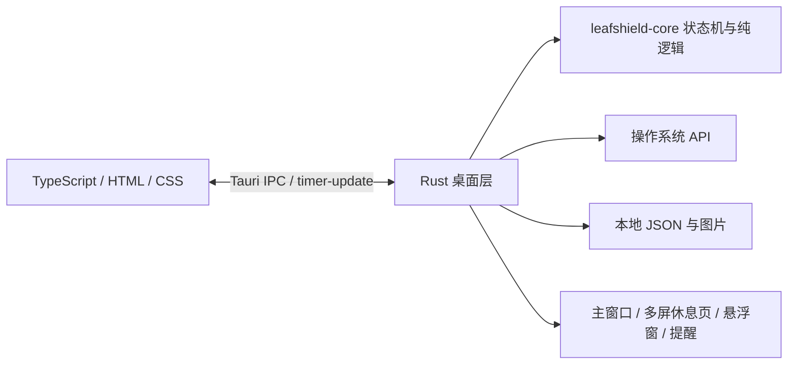

# 一叶 · LeafShield

[简体中文](README.md) | [English](README.en.md) · **作者：磊哥哥**

基于 Rust 和 Tauri 2 的桌面休息提醒与屏幕调节工具。通过定时休息、全屏壁纸和需要手动输入的正念文案，减少连续盯屏的时间。

当前版本 **0.5.4**，提供 Windows x64 便携版和安装包。软件界面及五条解锁预设目前为中文；项目文档提供中英文版本。

## 下载与运行

从 [Releases](https://github.com/chaseSpace/timetorest-rs/releases/latest) 下载：

| 文件                             | 用途                           |
| -------------------------------- | ------------------------------ |
| `leafshield-0.5.4.exe`           | 便携版，放在固定目录后直接运行 |
| `LeafShield_0.5.4_x64-setup.exe` | Windows 当前用户安装包         |
| `SHA256SUMS.txt`                 | 上述两个文件的 SHA256 校验值   |

需要 Microsoft Edge WebView2 Runtime。正式程序的界面资源嵌入 EXE，运行时不启动 HTTP 服务，不需要 Node.js 或 Vite。发行文件未做代码签名。

1. 运行程序，设置工作和休息时长，默认 **45 分钟工作 / 2 分钟休息**。
2. 到点后，每个显示器显示独立的置顶休息页，倒计时结束自动返回。
3. 提前结束时，移动鼠标或按键唤出解锁区域，逐字输入所选文案。
4. 关闭主窗口会收起到系统托盘，计时继续；从托盘重新打开窗口或退出。

**便携版也默认开启当前用户开机启动**，可在“选项 → 开机启动”关闭。登录启动时主界面隐藏在托盘。移动或重命名 EXE 后手动运行一次，会根据保存的偏好更新启动路径，无需管理员权限。

## 功能

| 功能             | 行为                                                                                                   |
| ---------------- | ------------------------------------------------------------------------------------------------------ |
| 计时             | 快捷组合 `25/2`、`45/2`、`60/3`、`90/5`；工作 1–240 分钟，休息 1–60 分钟；支持暂停、继续和立即休息     |
| 提前提醒         | 开启后，在休息前 60 秒和 30 秒发送系统通知及桌面轻量提醒                                               |
| 多屏休息页       | 默认隐藏解锁区域和鼠标；实际移动鼠标或按键后唤出，输入框自动聚焦；失去焦点后重新隐藏                   |
| 正念解锁         | 固定五条预设；提示文案不可选中或复制；输入框禁止粘贴和拖入；输错显示红色下划线，中文组合输入期间不误报 |
| 可选紧急通道     | 20 秒内手动按键 50 次；间隔超过 2 秒重置，长按不计数，成功解锁记录日志                                 |
| 悬浮计时         | 四边吸附、离开后收起、靠近展开；支持鼠标穿透和恢复位置，按工作区与 DPI 计算边界                        |
| 前台白名单       | 最多五个进程文件名；支持选择 EXE 或桌面 `.lnk`；仅匹配程序处于前台时延后休息                           |
| Windows 屏幕调节 | 色温 1500–6500K、亮度 20–100%；默认 5000K / 80%，拖动预览、松开保存                                    |
| 休息背景         | 林间、远山、星夜三张离线照片，每张最多 300 KB；支持导入自定义图片                                      |
| 本机记录         | 按日统计专注与休息时长、休息次数，保留最近 200 条日志；单实例运行                                      |

自定义背景接受 JPEG / PNG / WebP，原文件最多 5 MB、1600 万像素、任一边不超过 8192 像素。导入后校正方向，缩小至 1920×1200 内，移除原图元数据，存为不超过 500 KB 的 JPEG；只保留当前自定义文件。

## 界面预览

| 显示器                                                           | 计时器                                                             |
| ---------------------------------------------------------------- | ------------------------------------------------------------------ |
|  |  |

| 解锁文案                                                         | 关于                                                         |
| ---------------------------------------------------------------- | ------------------------------------------------------------ |
|  |  |

## 技术栈

| 层           | 技术与职责                                                                            |
| ------------ | ------------------------------------------------------------------------------------- |
| 桌面容器     | **Tauri 2**：系统 WebView、多窗口、托盘、通知、打包、单实例                           |
| 原生后端     | **Rust 2024 edition**：状态机、系统接口、图片处理、持久化和参数校验                   |
| 界面         | **TypeScript + HTML + CSS**，使用 **Vite** 构建，无 React / Vue 运行时                |
| 数据和图片   | `serde` / `serde_json`、`chrono`、`image`、`sha2`；本地 JSON 和文件，无数据库或服务端 |
| Windows 集成 | Win32 / Windows COM：系统颜色矩阵、键盘钩子、前台进程、快捷方式解析、当前用户启动项   |
| 验证和发布   | Rust 测试、rustfmt / Clippy、Playwright、GitHub Actions                               |

## 实现原理



### 计时与通信

[`leafshield-core`](crates/leafshield-core/src/lib.rs) 管理 `working`、`paused`、`resting`、`deferred` 四种状态，输出提醒、锁定、解锁等效果。Rust 后台线程每秒根据 `Instant` 单调时钟计算实际经过的时间，计时不依赖浏览器定时器。状态通过 `timer-update` 推送到各个 WebView；前端通过本地 Tauri IPC 发起操作，关键参数在 Rust 再次校验。

### 多屏与输入焦点

[`main.rs`](src-tauri/src/main.rs) 为每个显示器创建独立全屏置顶窗口，休息期间每三秒检查显示器变化。解锁区域最初透明且不接收鼠标点击，仅活动窗口提前准备输入焦点，以接收第一次按键和中文组合输入。

[`lock-screen.ts`](src/lock-screen.ts) 比较桌面物理鼠标坐标，并确认鼠标位于当前窗口内，过滤创建或定位窗口产生的移动消息。唤出时处理原生窗口、WebView 和文本框焦点；另一屏失去焦点后隐藏解锁区域。后端要求完整文案精确匹配；前端只对错字或多字标错，正确但尚未输完的前缀不报错。

### 色温与亮度

Windows 通过 [`MagSetFullscreenColorEffect`](https://learn.microsoft.com/windows/win32/api/magnification/nf-magnification-magsetfullscreencoloreffect) 设置系统全屏颜色矩阵，不使用橙色或黑色遮罩窗口。[颜色计算](src-tauri/src/display/colour.rs) 对黑体光谱和近似 CIE XYZ 匹配函数积分，转换为 RGB 增益，以 6500K 归一化；亮度乘在 RGB 增益上。颜色加法偏移保持零，黑色仍为黑色。

前端每 50ms 合并拖动预览，原生层用 180ms 平滑过渡，稳定后停止重复写入。关闭调节或正常退出恢复先前系统效果；6500K / 100% 为中性设置。色温是近似白点，亮度是软件调暗，**不调整硬件背光，也不等于显示器校色**。

### 悬浮窗与系统集成

[`docking.rs`](crates/leafshield-core/src/docking.rs) 使用物理像素计算吸附和收起后的窄条矩形；[`widget_dock.rs`](src-tauri/src/widget_dock.rs) 检查鼠标与显示器工作区，直接缩小原生窗口，避免把大部分窗口移到相邻屏幕。

Windows 白名单通过前台窗口确定进程，`.lnk` 使用 COM 解析目标 EXE，选择时不启动文件。启动项使用当前用户的 `HKCU\Software\Microsoft\Windows\CurrentVersion\Run`，并独立记录用户关闭自启的选择。键盘钩子检查需要拦截的系统组合键，不保存任意键入内容。

### 本地存储与图片

Windows 数据目录为 `%APPDATA%\com.leafshield.desktop\`，包含 `settings.json`、`startup.json` 和自定义背景。设置先写临时文件再原子替换；短暂文件占用会重试，损坏 JSON 会保留备份并恢复默认值。设置、统计和日志会保存，**重启后开始新的工作周期**。

图片在 Rust 端限制尺寸和解码内存、重新编码，用处理后内容的 SHA256 命名。图片只在背景改变时加载，不混入每秒计时事件。

## 从源码构建

需要 Node.js **22.12+**、Rust stable 和对应平台的 Tauri 原生依赖。Windows 另需 MSVC C++ Build Tools、Windows SDK 和 WebView2。

```powershell
git clone git@github.com:chaseSpace/timetorest-rs.git
cd timetorest-rs
npm ci
npm run build             # 便携版 → artifacts/leafshield-0.5.4.exe
npm run build:installer   # Windows NSIS 安装包
```

构建校验值写入 `artifacts/SHA256SUMS.txt`。`artifacts/leafshield.exe` 是本地运行副本；旧副本被占用时保留旧文件，请运行新的带版本号文件。生成安装包不会自动安装。

Windows 构建脚本支持 `CARGO_HOME`、`RUSTUP_HOME`、`CARGO_TARGET_DIR`，并为旧终端补读系统级 Rust 环境。设置 `CARGO_HOME` 时，默认缓存使用其下的 `targets/leafshield`。项目 [`.cargo/config.toml`](.cargo/config.toml) 使用 RsProxy，删除镜像配置即可直连 crates.io；托管发布 runner 使用 crates.io。

```powershell
npm run build:web         # TypeScript 检查和静态资源构建
npm run test:rust         # Rust 工作区测试
npm run check:rust        # rustfmt / Clippy
npm run test:ui           # Playwright 直接拦截请求读取 dist，无 HTTP 服务
npm run smoke             # 原生启动 / IPC 检查，需先构建并退出已有实例
```

Windows UI 测试使用系统 Edge，其他系统先执行 `npx playwright install chromium`。[原生检查脚本](scripts/) 可能移动鼠标、打开预览或临时调整设置，不应与手动验收同时运行。自动化检查不能替代真实双屏、输入法和休息流程验收。

只有显式执行 `npm run desktop` / `npm run dev` 时，才启动本机 Vite 开发服务 `127.0.0.1:1420`。

### 平台状态

| 平台          | 当前范围                                                                                                                |
| ------------- | ----------------------------------------------------------------------------------------------------------------------- |
| Windows x64   | 本次发布平台，已完成本机发布编译及部分原生验证；最新双屏交互仍由用户手动验收                                            |
| macOS         | 提供源码适配和 CI 配置；需要 Xcode Command Line Tools，键盘防护需要辅助功能授权；本次未提供安装包或完成真机验收         |
| Linux X11     | 提供源码适配和 CI 配置；依赖 GTK / WebKitGTK / AppIndicator / X11，前台检测使用 `xprop`；本次未提供安装包或完成真机验收 |
| Linux Wayland | 全局键盘、前台检测和置顶行为受合成器限制，不保证与 X11 一致                                                             |

Ubuntu / Debian 依赖示例：

```sh
sudo apt-get install libwebkit2gtk-4.1-dev build-essential curl wget file libxdo-dev libssl-dev librsvg2-dev libayatana-appindicator3-dev libx11-dev x11-utils
```

## 发布

更新 `package.json`、`package-lock.json`、`src-tauri/Cargo.toml`、`Cargo.lock`、`src-tauri/tauri.conf.json` 和界面版本号，在 `docs/releases/` 添加版本说明后推送 `v<版本号>` 标签。[发布工作流](.github/workflows/release.yml) 校验版本，构建 Windows 便携版和 NSIS 安装包，为两个资产生成独立校验文件，全部上传完成后公开 Release。失败的上传保留为草稿。

## 使用边界与资料

这是自愿使用的休息工具，不能阻止 Ctrl+Alt+Del、安全桌面、操作系统级注销或强制结束进程；软件调色也不保证覆盖安全桌面和独占全屏。整体内存需要计入系统 WebView 子进程，不能只看 Rust 宿主占用。

- [默认背景图片来源与许可](public/wallpapers/SOURCES.md)，摄影作品许可独立于应用代码。
- `zzz/` 为本地工作记录，`artifacts/` 为构建和验证产物，均不随源码提交。
