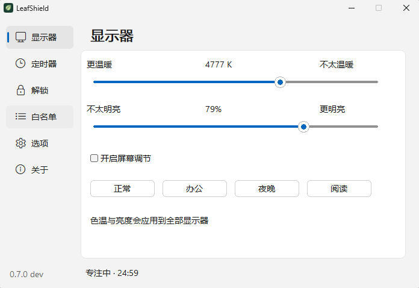
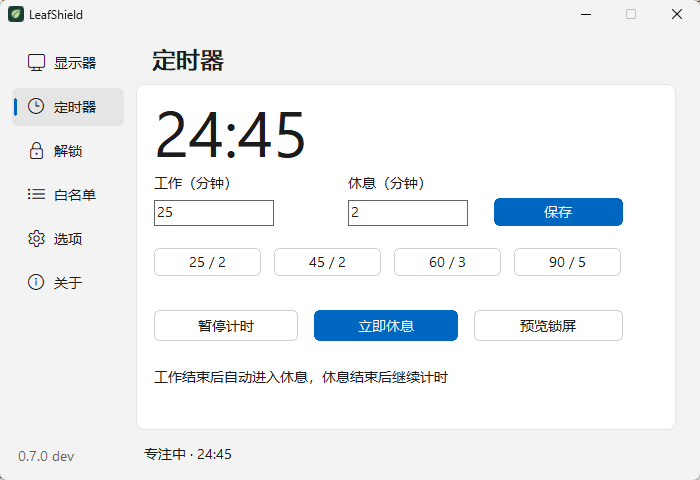
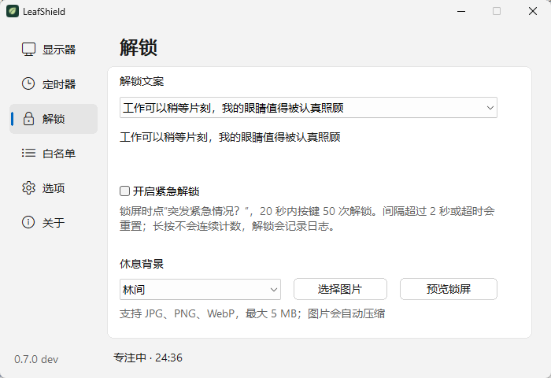
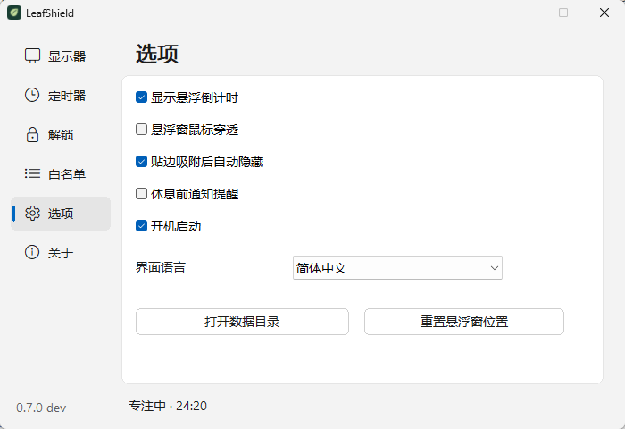

# 一叶 · LeafShield

简体中文 | [English](README.en.md) · **作者：Leigg**

一款轻量的护眼休息工具，支持定时休息、色温与亮度调节、悬浮倒计时，以及需要手动输入文案才能提前结束的休息锁屏。为了降低内存占用，UI
使用平台原生控件实现。

当前正式版本：**0.7.1**，源码位于 **`main`**，Windows 开发分支保留为 `dev.win`。面向 **Windows 11 x64**，Windows 10
兼容性尚未完整验证；**Mac 端正在开发中，暂不支持 Linux**。

Windows 版运行时无需 WebView2、浏览器或 Node.js，也不启动 HTTP 服务。

## 界面预览

### 色温与亮度



### 定时休息



### 解锁与背景



### 选项



## 功能

| 功能      | 当前行为                                                                 |
|---------|----------------------------------------------------------------------|
| 工作与休息计时 | 默认工作 45 分钟、休息 2 分钟；预设 `25/2`、`45/2`、`60/3`、`90/5`，支持自定义时长、暂停、继续和立即休息 |
| 屏幕调节    | 色温 1500–6500 K、亮度 20–100%；默认 5000 K / 80%，向左更温暖，应用到全部显示器及常用系统鼠标指针 |
| 多屏休息    | 每个显示器显示置顶休息窗口，到点自动结束；默认隐藏鼠标和解锁区域，活动屏幕唤出输入框                           |
| 正念解锁    | 五条固定文案，手动完整输入后可提前结束；提示不可复制，输入框禁止粘贴，错字显示红色下划线                         |
| 紧急解锁    | 可选开关，附操作说明；20 秒内手动按键 50 次，间隔超过 2 秒或超时重置，长按不连续计数，成功后记录日志              |
| 悬浮倒计时   | 可拖动、四边吸附隐藏、靠近展开、鼠标穿透和重置位置；右键菜单与系统托盘一致                                |
| 前台白名单   | 最多五个进程文件名，支持选择 EXE 或桌面 `.lnk`；指定程序位于前台时延后自动休息                        |
| 休息背景    | 内置林间、远山、夜空三张离线照片，支持自定义 JPEG / PNG / WebP                             |
| 本机配置    | 设置、每日统计和最近 200 条日志保存在本地 JSON；支持当前用户开机启动                              |
| 中英文     | 在“选项 → 界面语言”切换；设置、休息窗口、悬浮窗、托盘和五条文案一起切换                               |

自定义背景原文件最大 5 MB、1600 万像素、任一边不超过 8192 像素；导入后规范化为 1920×1200 以内、不超过 500 KB 的 JPEG。

鼠标指针保留当前主题的大小、点击位置与透明区域，关闭屏幕调节或正常退出时恢复。动画和应用自定义指针不参与调整；用户中途更换指针主题时，停止覆盖已更改的指针。

## 下载与运行

从 [Windows 正式版 0.7.1](https://github.com/chaseSpace/timetorest-rs/releases/tag/v0.7.1) 下载：

| 文件                            | 用途                     |
|-------------------------------|------------------------|
| `leafshield-native-0.7.1.exe` | Windows x64 便携程序       |
| `SHA256SUMS.txt`              | EXE 和许可文件的 SHA-256 校验值 |
| `LICENSE`                     | MIT 许可                 |

下载 EXE 后直接运行，无需安装。该版本没有代码签名，Windows 可能显示安全提示，请使用同一发行中的校验文件核对下载内容。GitHub
Releases 中的 **0.6.x 属于历史 Tauri 版本**。

1. 从托盘退出旧版，再运行新的 EXE。
2. 在“定时器”选择时间组合；“预览锁屏”可查看休息界面。
3. 关闭设置窗口后，托盘和计时继续运行；从托盘重新打开或退出。
4. 在“选项”设置开机启动。启用后请把 EXE 放在固定目录；移动程序后重新切换该选项以更新路径。开发版启动时不自动改写已有启动项。

配置沿用 `%APPDATA%\com.leafshield.desktop`。首次运行原生版会备份已有配置；也可从“选项 → 打开数据目录”查看本机数据。

## 从源码构建

Windows 构建需要 Rust stable、MSVC C++ Build Tools 和 Windows SDK。使用项目命令时另需 Node.js 22+。

在 `main` 分支的仓库目录执行：

```powershell
npm run build:native
```

本地生成文件：

| 文件                                                 | 用途                     |
|----------------------------------------------------|------------------------|
| `artifacts/native-dev/leafshield-native-0.7.1.exe` | Windows x64 便携程序       |
| `artifacts/native-dev/SHA256SUMS.txt`              | EXE 和许可文件的 SHA-256 校验值 |
| `artifacts/native-dev/LICENSE`                     | MIT 许可                 |

也可直接使用 Rust 工具链构建，程序生成到 Cargo 的 `release` 输出目录：

```powershell
cargo build --release -p leafshield-native
```

## 资源占用

本机 `0.7.0-dev.4` 的一次常驻快照：

这些内存数据属于旧版基线；`0.7.1` 新增指针同步后的常驻内存尚未重新测量。

| 指标               |                                   实测值 |
|------------------|--------------------------------------:|
| 专用工作集            |                          **2.19 MiB** |
| 私有提交量            |                          **2.84 MiB** |
| Windows 原生便携 EXE | **1.65 MiB**（GitHub 构建为 1,733,632 字节） |
| 总工作集             |                             20.93 MiB |

## 技术栈

| 部分      | 使用技术                                                           |
|---------|----------------------------------------------------------------|
| 应用与业务核心 | Rust 2024 edition、`leafshield-core`                            |
| UI      | 使用平台原生控件实现；Windows 版已发布，Mac 端正在开发中                             |
| 系统功能    | Windows 颜色矩阵、键盘钩子、系统托盘、文件选择与快捷方式解析、当前用户启动项                     |
| 数据与图片   | `serde` / `serde_json`、`chrono`、`image`、`sha2`                 |
| 检查与构建   | Rust 测试、rustfmt、Clippy、PowerShell / C# 原生界面自动检查、GitHub Actions |

## 验证

```powershell
cargo test -p leafshield-core -p leafshield-native
cargo fmt --all -- --check
cargo clippy -p leafshield-core -p leafshield-native --all-targets -- -D warnings
npm run test:native-ui
```

`0.7.1` 通过 **44 项 Rust 测试**，含 5 项指针色彩、几何及恢复保护测试；1 项会实际调整桌面颜色的测试默认跳过。此前 `0.7.0-dev.4` 的 18 项界面自动检查覆盖滑杆轨道、点击定位、拖动与残影、中英文紧急说明、托盘菜单和设置窗口操作；本次未重跑，鼠标实际联动与退出恢复仍待人工验收。

界面自动检查使用临时配置，测试期间不启用全局键盘钩子或系统调色，也不改写正常启动项。因此，上述结果不代替真实双屏休息、输入法、颜色恢复和开机登录验收。更多说明见 [Windows 原生开发版](docs/native-windows.md)。

## 许可与鸣谢

项目代码采用 [MIT License](LICENSE)
。默认背景照片遵循各自许可，来源及摄影师署名见 [图片来源](public/wallpapers/SOURCES.md)。

感谢 **CareUEyes**，本项目的界面设计和部分功能参考了该软件。

这是一个休息提醒工具，不能阻止 Ctrl+Alt+Del、安全桌面或强制结束进程。
